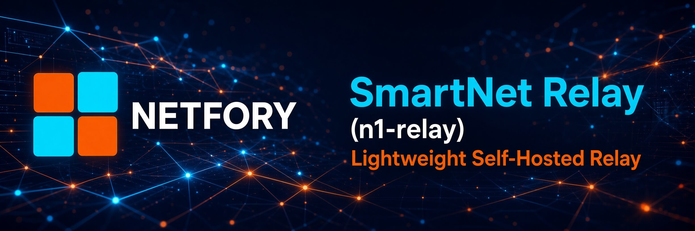

# SmartNet Relay (n1-relay)
Лёгкий, самостоятельно размещаемый **relay** сервер для P2P-сети NETFORY

Операторы запускают его на своих серверах, а клиенты SmartNet могут *по желанию*
маршрутизировать трафик через эти релеи - в дополнение к стандартным публичным
релеям n0 (n0-computer).

> Крейт: `smartnet-relay` · бинарь: `smartnet-relay` · основа: `iroh-relay = "1.0"` (feature `server`)

---

## 1. Что такое relay и зачем он нужен

Два узла стараются установить **прямое** соединение (hole-punching через
QUIC). Когда оба пира за "строгими" NAT/файрволами и пробить прямой путь не
удаётся, трафик идёт через **relay** - промежуточный сервер, который просто
пересылает зашифрованные пакеты между пирами. Relay **не расшифровывает** данные:
вся E2EE-криптография SmartNet (X25519 + AES-256-GCM) остаётся между конечными
узлами. Relay видит только зашифрованный транзит и помогает с обнаружением
адресов (QAD - QUIC Address Discovery).

По умолчанию SmartNet-клиент использует публичные релеи **n0**. `n1-relay` - это
наша **собственная** релей-инфраструктура ("n1" = "network tier 1", релеи
сообщества SmartHoldem).

### Зачем хостить свой релей
- **Независимость** - сеть продолжает работать, даже если публичные релеи n0
  недоступны или ограничены.
- **Скорость / география** - релей рядом с пользователями (свой регион) даёт
  меньшую задержку при transit-доставке сообщений и блобов.
- **Приватность** - в режиме `relay_only` (Settings > Network) клиент не
  раскрывает свой прямой IP пирам, а весь трафик идёт через релей. Хостинг
  собственного релея означает, что доверять приходится только своему серверу.
- **Контроль пропускной способности** - вы сами управляете лимитами и ресурсами.
- **Отказоустойчивость** - можно поднять несколько релеев в разных дата-центрах
  и раздать клиентам их список; сеть сама выберет лучший.

---

## 2. Возможности

| Возможность | Описание |
|---|---|
| Relay HTTP-эндпоинт | Полноценный smartnet-relay (`/relay`) для пересылки зашифрованного P2P-трафика. |
| QAD (QUIC Address Discovery) | Помогает пирам узнавать свои внешние адреса для hole-punching. |
| Plain-HTTP (без TLS) | Релей слушает чистый HTTP - TLS навешивается снаружи (reverse-proxy), что упрощает деплой и ротацию сертификатов. |
| Конфигурация через ENV | Хост и порт задаются переменными окружения, без правки кода. |
| Graceful shutdown | Корректная остановка по `Ctrl-C` (SIGINT) - релей завершает задачи и закрывает соединения. |
| Структурированные логи | `tracing` + `tracing-subscriber` с фильтром через `RUST_LOG`. |
| Минимальные зависимости | Только `smartnet-relay` (server) + `tokio` + `tracing`. Маленький бинарь, низкое потребление ресурсов. |

> ❗ Релей **не** хранит сообщения и **не** имеет доступа к ключам/контенту -
> он только пересылает зашифрованные пакеты. Это "тупой", но надёжный транзит.

---

## 3. Структура проекта

```
/app/smartnet-relay/
├── Cargo.toml          # зависимости (smartnet-relay feature "server", tokio, tracing)
├── src/
│   └── main.rs         # точка входа: конфиг из ENV > Server::spawn > ждём Ctrl-C
```

`Cargo.toml` (ключевое):
```toml
[dependencies]
smartnet-relay = { version = "1.0", features = ["server"] }   # feature "server" обязателен
tokio = { version = "1", features = ["rt-multi-thread", "macros", "signal"] }
tracing = "0.1"
tracing-subscriber = { version = "0.3", features = ["env-filter"] }
```

> ⚠️ Без `features = ["server"]` модуль `iroh_relay::server` недоступен
> (ошибка `error[E0432]: unresolved import iroh_relay::server`).

---

## 4. Переменные окружения

| Переменная | Назначение | По умолчанию |
|---|---|---|
| `SMARTNET_RELAY_HOST` | Адрес привязки (bind) HTTP-сервера | `0.0.0.0` |
| `SMARTNET_RELAY_PORT` | Порт привязки HTTP-сервера | `3340` |
| `RUST_LOG` | Уровень/фильтр логов (`tracing`) | `smartnet_relay=info,iroh_relay=info` |

---

## 5. Установка и запуск

### Требования
- Rust (stable) + Cargo - https://rustup.rs
- Открытый порт (по умолчанию `3340`) на сервере / в файрволе.

### Сборка
```bash
cd /smartnet-relay

# Проверка компиляции
cargo check

# Релизная сборка (оптимизированный бинарь)
cargo build --release
# бинарь: ./target/release/smartnet-relay
```

### Запуск
```bash
# С настройками по умолчанию (0.0.0.0:3340)
cargo run --release

# Или напрямую бинарём, с переопределением порта/хоста и логов
SMARTNET_RELAY_HOST=0.0.0.0 \
SMARTNET_RELAY_PORT=3340 \
RUST_LOG=smartnet_relay=info,iroh_relay=debug \
./target/release/smartnet-relay
```

При успешном старте в консоль выведется:
```
SmartNet relay (n1-relay) up on http://0.0.0.0:3340  - front with HTTPS and point clients at https://<your-host>
```

Остановка - `Ctrl-C` (graceful shutdown).

---

## 6. Продакшн-деплой (HTTPS через reverse-proxy)

Сам релей слушает **чистый HTTP**. Для интернета поставьте перед ним
reverse-proxy с TLS (Caddy / Nginx / Traefik). Клиентам раздаётся уже
**HTTPS**-URL вашего хоста.

### Вариант A - Caddy (автоматический Let's Encrypt)
```caddy
# /etc/caddy/Caddyfile
relay.smartholdem.io {
    reverse_proxy 127.0.0.1:3340
}
```

### Вариант B - Nginx
```nginx
server {
    listen 443 ssl;
    server_name relay.smartholdem.io;

    ssl_certificate     /etc/letsencrypt/live/relay.smartholdem.io/fullchain.pem;
    ssl_certificate_key /etc/letsencrypt/live/relay.smartholdem.io/privkey.pem;

    location / {
        proxy_pass http://127.0.0.1:3340;
        proxy_http_version 1.1;
        proxy_set_header Upgrade $http_upgrade;      # WebSocket-апгрейд relay
        proxy_set_header Connection "upgrade";
        proxy_set_header Host $host;
        proxy_read_timeout 86400s;                   # долгоживущие соединения
    }
}
```
> Релей использует WebSocket-апгрейд, поэтому заголовки `Upgrade`/`Connection`
> и большой `proxy_read_timeout` обязательны.

### systemd-сервис (автозапуск)
```ini
# /etc/systemd/system/smartnet-relay.service
[Unit]
Description=SmartNet Relay (n1-relay)
After=network.target

[Service]
Environment=SMARTNET_RELAY_HOST=127.0.0.1
Environment=SMARTNET_RELAY_PORT=3340
Environment=RUST_LOG=smartnet_relay=info,iroh_relay=info
ExecStart=/opt/smartnet-relay/smartnet-relay
Restart=always
RestartSec=3

[Install]
WantedBy=multi-user.target
```
```bash
sudo systemctl daemon-reload
sudo systemctl enable --now smartnet-relay
sudo journalctl -u smartnet-relay -f   # логи
```

> Совет: для нескольких релеев поднимите по экземпляру в разных регионах и
> раздайте клиентам **все** их URL - система выберет наилучший по задержке.

---

## 7. Подключение к фронтенду SmartNet

Пользователь подключает кастомные релеи прямо из приложения - **без пересборки
клиента**.

### Где (UI)
`Настройки > Сеть > SmartNet Relays (n1-relay)`
(`Settings.vue`, блок `data-testid="n1-relay-row"`):
- **Тоггл** `n1-relay-toggle` - вкл/выкл использование кастомных релеев.
- **Поле ввода** `n1-relay-input` - список URL релеев, **по одному в строке**
  (например `https://relay.smartholdem.io`).
- **Кнопка** `save-n1-relay-btn` - сохранить.

### Что происходит под капотом
1. **Фронтенд** (`Settings.vue`) вызывает мост `bridge.ts`:
    - `getRelayConfig()` - загружает текущие настройки `onMount`.
    - `setRelayConfig(enabled, urls)` - сохраняет тоггл и список URL.
2. **Tauri-команды** (Rust, `p2p.rs`, зарегистрированы в `lib.rs`):
    - `get_relay_config` / `set_relay_config` - читают/пишут настройки в
      локальную **sled**-БД под ключами `cfg:n1_relay_enabled` и
      `cfg:n1_relay_urls` (JSON-массив строк). Пустые строки отфильтровываются.
3. **Применение к iroh-endpoint** (`p2p.rs`, `mod p2p_impl::apply_smartnet_relays`):
   при инициализации P2P-узла, если тоггл включён, каждый валидный URL парсится
   в `iroh::RelayUrl` и добавляется в relay-map endpoint-а **рядом** со
   стандартными релеями n0:
   ```rust
   let rc = RelayConfig::new(url.clone(), Some(RelayQuicConfig::default()));
   endpoint.insert_relay(url, Arc::new(rc)).await;
   ```
   То есть кастомные релеи **дополняют**, а не заменяют публичные - связность
   сохраняется, даже если один из ваших релеев недоступен.

### Какой URL вписывать
- За reverse-proxy с TLS: `https://relay.smartholdem.io` (рекомендуется для прод).
- Локальный тест без TLS: `http://<ip>:3340`.

### Важно про идентичность узла
Релей **не требует** регистрации/ключей со стороны клиента. Менять список релеев
можно в любой момент; новые настройки применяются при следующей инициализации
P2P-узла (перезапуск приложения гарантированно подхватывает изменения).

---

## 8. Проверка работоспособности

```bash
# 1. Релей слушает порт?
ss -ltnp | grep 3340

# 2. HTTP отвечает (релей поднят)?
curl -i http://127.0.0.1:3340/

# 3. Через прокси (TLS) снаружи
curl -i https://relay.smartholdem.io/
```
В приложении: включите тоггл, впишите URL, сохраните - в логах релея при
обращении клиентов появятся записи соединений (`RUST_LOG=...=debug` для деталей).

---

## 9. Частые проблемы

| Симптом | Причина / решение |
|---|---|
| `error[E0432]: unresolved import iroh_relay::server` | В `Cargo.toml` не включён feature `server` у `smartnet-relay`. |
| Клиент не подключается через релей | URL должен быть `https://...` (через TLS-прокси) либо `http://ip:port` в локальной сети; проверьте открытость порта и заголовки `Upgrade`/`Connection` в прокси. |
| Соединения рвутся через ~минуту | Увеличьте `proxy_read_timeout` (релей держит долгоживущие WS-соединения). |
| Нет логов | Задайте `RUST_LOG=smartnet_relay=info,iroh_relay=debug`. |
| Порт занят | Поменяйте `SMARTNET_RELAY_PORT` или освободите порт. |

---

## 10. Безопасность и приватность

- Релей пересылает **только зашифрованный** трафик; контент сообщений и ключи
  ему недоступны (E2EE остаётся на конечных узлах).
- Релей видит факт соединения и сетевые адреса транзита - поэтому хостите релей
  на доверенной инфраструктуре, если включаете `relay_only`.
- Рекомендуется всегда выставлять релей наружу через **HTTPS** (TLS-прокси).
